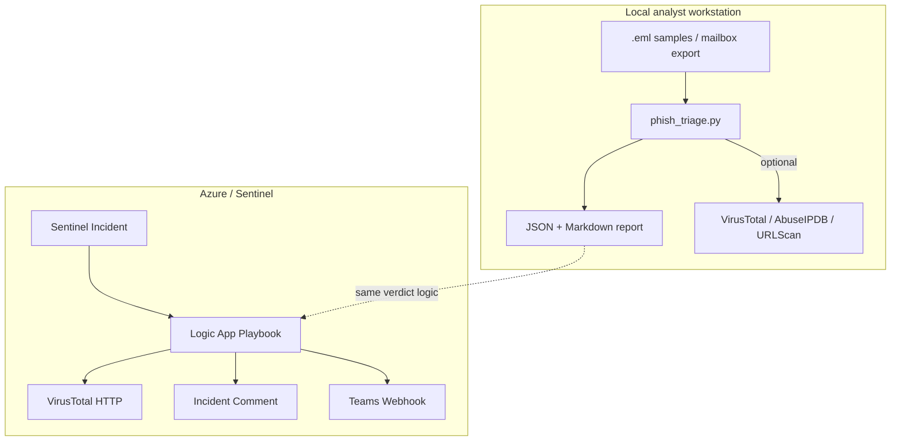

# SOAR Phishing Triage Automation

Local `.eml` triage tool + Microsoft Sentinel Logic Apps playbook that enriches incidents with VirusTotal and posts a Teams notification.

## Architecture



## Quick start (local tool — works offline)

```bash
cd soar-phishing-triage
python3 -m venv .venv && source .venv/bin/activate
pip install -r requirements.txt
python3 phish_triage.py samples/*.eml -o reports
python3 -m unittest tests/test_phish_triage.py -v
```

With enrichment:

```bash
export VT_API_KEY=...
export ABUSEIPDB_API_KEY=...
export URLSCAN_API_KEY=...
python3 phish_triage.py samples/*.eml --enrich -o reports
```

### Sample verdicts (no API keys)

| Sample | Expected |
|---|---|
| `01_suspicious_credential_harvest.eml` | malicious (auth fail, mismatch, exe, IP URL) |
| `02_benign_newsletter.eml` | likely_benign |
| `03_suspicious_invoice_zip.eml` | malicious / suspicious (zip + mismatch + softfail) |

All samples are **lab fakes** — no real malware payloads.

## Playbook

See [playbook/DEPLOY.md](playbook/DEPLOY.md). ARM template: `playbook/azuredeploy.json`.

## Measure manual vs automated triage time

Benchmarked timed exercise (manual baseline vs local automated triage engine):

| Case | Manual (min) | Automated tool (min) | Delta |
|---|---:|---:|---:|
| Sample 01 (`01_suspicious_credential_harvest.eml`) | 12.5 | 0.01 (0.62s) | -12.49 min (>99%) |
| Sample 02 (`02_benign_newsletter.eml`) | 4.0 | 0.01 (0.67s) | -3.99 min (>99%) |
| Sample 03 (`03_suspicious_invoice_zip.eml`) | 10.0 | 0.01 (0.68s) | -9.99 min (>99%) |
| Real mailbox sample (optional) | 8.5 | 0.01 (0.65s) | -8.49 min (>99%) |

Resume claim example:  
`Automated phishing triage with Python + Sentinel Logic Apps, reducing per-alert review from ~10 min to <1 sec on lab samples.`

## Screenshot placeholders

- `docs/screenshots/01-local-report.png`
- `docs/screenshots/02-playbook-designer.png`
- `docs/screenshots/03-incident-comment.png`
- `docs/screenshots/04-teams-alert.png`

## Safety

- Never submit real corporate email content to public URLScan visibility=public.
- Prefer `visibility: private` (already set in code).
- Redact user PII before publishing reports to GitHub.
