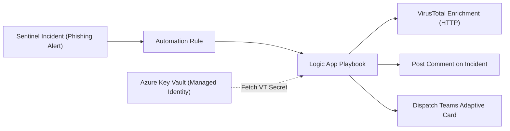

# Deploying Microsoft Sentinel SOAR Phishing Playbook

This guide details how to deploy and configure the **Microsoft Sentinel Logic App Playbook** (`azuredeploy.json`) to automate phishing incident enrichment, comment logging, and Microsoft Teams alerting.

---

## Architecture Overview



---

## Prerequisites

1. **Azure Subscription**: An active Azure account (free trial or paid).
2. **Microsoft Sentinel Workspace**: A Log Analytics workspace with Microsoft Sentinel enabled.
3. *(Recommended)* **Azure Key Vault**: To securely store the VirusTotal API key without baking secrets into templates.
4. *(Optional)* **VirusTotal API Key**: Free community API key from [VirusTotal](https://www.virustotal.com/).
5. *(Optional)* **Microsoft Teams Incoming Webhook**: A webhook URL created in your SOC or alert channel.

---

## Deployment Parameters

| Parameter | Type | Default | Description |
|---|---|---|---|
| `PlaybookName` | `string` | `Sentinel-Phishing-Triage-Playbook` | Name of the Logic App workflow resource. |
| `KeyVaultName` | `string` | `""` | *(Recommended)* Azure Key Vault name containing the `VirusTotalApiKey` secret. If supplied, the Logic App fetches the key at runtime via System-Assigned Managed Identity. |
| `VirusTotalApiKey` | `securestring` | `""` | *(Alternative)* Direct VirusTotal API v3 key if not using Azure Key Vault. |
| `TeamsWebhookUrl` | `securestring` | `""` | Incoming Webhook URL for Microsoft Teams channel alerting (leave blank to skip). |

> [!NOTE]
> All HTTP actions handling API keys and Webhook URLs have **Secure Inputs and Secure Outputs** enabled (`runtimeConfiguration.secureData`), ensuring secrets and webhook URLs are masked with `******` and never exposed in the Logic App run history.

---

## Deployment Methods

### Option A: Deploy via Azure Portal (GUI)

1. Sign in to the [Azure Portal](https://portal.azure.com).
2. In the top search bar, search for **Deploy a custom template** and select it.
3. Click **Build your own template in the editor**.
4. Click **Load file** and select `playbook/azuredeploy.json` from this repository.
5. Click **Save**.
6. Fill in the deployment parameters:
   - **Subscription**: Your Azure subscription.
   - **Resource group**: Select the resource group where your Sentinel workspace resides (e.g. `rg-soc-lab`).
   - **Region**: Same region as your Sentinel workspace.
   - **Playbook Name**: `Sentinel-Phishing-Triage-Playbook`.
   - **Key Vault Name**: *(Recommended)* Name of your Azure Key Vault containing the `VirusTotalApiKey` secret.
   - **Teams Webhook URL**: Paste your Teams incoming webhook URL (or leave blank).
   - **VirusTotal API Key**: Paste your VT API key if not using Key Vault (or leave blank).
7. Click **Review + create**, then **Create**.

---

### Option B: Deploy via Azure CLI

Run the following command in Azure Cloud Shell or local terminal:

```bash
az deployment group create \
  --resource-group "<YOUR_RESOURCE_GROUP>" \
  --template-file "playbook/azuredeploy.json" \
  --parameters \
    PlaybookName="Sentinel-Phishing-Triage-Playbook" \
    KeyVaultName="<YOUR_KEYVAULT_NAME>" \
    TeamsWebhookUrl="<YOUR_TEAMS_WEBHOOK_URL>" \
    VirusTotalApiKey="<YOUR_VT_API_KEY>"
```

---

## Permissions & Security Setup

### 1. Grant Sentinel Incident Permissions (Required)

For the Logic App to append automated triage comments to Sentinel incidents:

1. Navigate to your deployed **Logic App** (`Sentinel-Phishing-Triage-Playbook`).
2. Under **Settings**, select **Identity** and copy the **Object (principal) ID** under the **System assigned** tab.
3. Go to your **Sentinel Resource Group** -> **Access control (IAM)** -> **Add role assignment**.
4. Role: **Microsoft Sentinel Responder**.
5. Assign access to: **Managed identity** -> Select `Sentinel-Phishing-Triage-Playbook`.
6. Click **Review + assign**.

### 2. Grant Key Vault Access (If using KeyVaultName)

If you specified a `KeyVaultName`:

1. Store the secret in your Key Vault:
   ```bash
   az keyvault secret set --vault-name "<YOUR_KEYVAULT_NAME>" --name "VirusTotalApiKey" --value "<YOUR_VT_API_KEY>"
   ```
2. Grant the Logic App Managed Identity read permission:
   - **Azure RBAC permission model**:
     In your Key Vault -> **Access control (IAM)** -> **Add role assignment** -> **Key Vault Secrets User** -> assign to `Sentinel-Phishing-Triage-Playbook`.
   - **Vault Access Policy model**:
     In your Key Vault -> **Access policies** -> **Create** -> Select **Get** under Secret permissions -> Select `Sentinel-Phishing-Triage-Playbook` principal -> Save.

### 3. Authorize Sentinel API Connection

1. In your resource group, open the API Connection resource: `azuresentinel-phishing-triage`.
2. Under **General**, click **Edit API connection**.
3. Click **Authorize**, authenticate with your Sentinel-authorized account, and click **Save**.

---

## Configure Sentinel Automation Rule

1. Open **Microsoft Sentinel** in the Azure Portal.
2. Under **Configuration**, select **Automation**.
3. Click **Create** -> **Automation rule**.
4. Configure the rule:
   - **Rule name**: `Auto-Triage Phishing Incidents`
   - **Trigger**: `When incident is created`
   - **Conditions**: `Incident title Contains Phishing` (or matching your analytics rule).
   - **Actions**: `Run playbook` -> Select `Sentinel-Phishing-Triage-Playbook`.
5. Click **Apply**.

---

## Free-Tier ($0 Cost) Verification

- **Microsoft Sentinel**: 31-day trial on a new Log Analytics workspace (up to 10 GB/day ingestion free).
- **Logic Apps (Consumption)**: Generous free execution allowance monthly.
- **Azure Key Vault**: Standard tier free/micro-cents (first 10,000 operations free or pennies).
- **VirusTotal**: Free community API tier (4 requests/minute).
