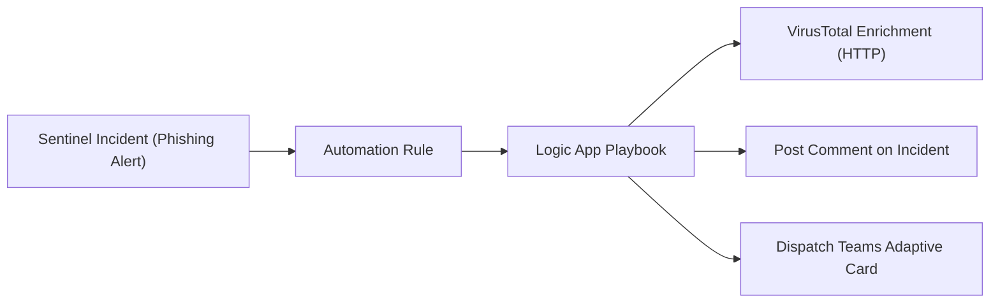

# Deploying Microsoft Sentinel SOAR Phishing Playbook

This guide details how to deploy and configure the **Microsoft Sentinel Logic App Playbook** (`azuredeploy.json`) to automate phishing incident enrichment, comment logging, and Microsoft Teams alerting.

---

## Architecture Overview



---

## Prerequisites

1. **Azure Subscription**: An active Azure account (free trial or paid).
2. **Microsoft Sentinel Workspace**: A Log Analytics workspace with Microsoft Sentinel enabled.
3. *(Optional)* **VirusTotal API Key**: Free community API key from [VirusTotal](https://www.virustotal.com/).
4. *(Optional)* **Microsoft Teams Incoming Webhook**: A webhook URL created in your SOC or alert channel.

---

## Deployment Methods

### Option A: Deploy via Azure Portal (GUI)

1. Sign in to the [Azure Portal](https://portal.azure.com).
2. In the top search bar, search for **Deploy a custom template** and select it.
3. Click **Build your own template in the editor**.
4. Click **Load file** and select `playbook/azuredeploy.json` from this repository.
5. Click **Save**.
6. Fill in the deployment parameters:
   - **Subscription**: Your Azure subscription.
   - **Resource group**: Select the resource group where your Sentinel workspace resides.
   - **Region**: Same region as your Sentinel workspace.
   - **Playbook Name**: `Sentinel-Phishing-Triage-Playbook` (or your choice).
   - **Teams Webhook URL**: Paste your Teams webhook URL (leave blank to skip Teams alerting).
   - **VirusTotal API Key**: Paste your VT API key (leave blank to skip VT enrichment).
7. Click **Review + create**, then **Create**.

---

### Option B: Deploy via Azure CLI

Run the following command in PowerShell or Bash:

```bash
az deployment group create \
  --resource-group "<YOUR_RESOURCE_GROUP>" \
  --template-file "playbook/azuredeploy.json" \
  --parameters \
    PlaybookName="Sentinel-Phishing-Triage-Playbook" \
    TeamsWebhookUrl="<YOUR_TEAMS_WEBHOOK_URL>" \
    VirusTotalApiKey="<YOUR_VT_API_KEY>"
```

---

## Post-Deployment Permissions Setup

For the Logic App to add comments to Sentinel incidents, it requires RBAC permissions.

### 1. Grant Managed Identity Permission
1. Navigate to the deployed **Logic App** (`Sentinel-Phishing-Triage-Playbook`).
2. Under **Settings**, select **Identity**.
3. Note the **Object (principal) ID** under the System assigned tab.
4. Go to your **Log Analytics / Sentinel Resource Group** -> **Access control (IAM)** -> **Add role assignment**.
5. Select the role **Microsoft Sentinel Responder**.
6. Assign access to: **Managed identity** -> Select `Sentinel-Phishing-Triage-Playbook`.
7. Click **Review + assign**.

### 2. Authorize the Sentinel API Connection
1. In your resource group, open the API Connection resource: `azuresentinel-phishing-triage`.
2. Under **General**, click **Edit API connection**.
3. Click **Authorize**, sign in with your Sentinel-authorized account, and click **Save**.

---

## Configure Sentinel Automation Rule

1. Open **Microsoft Sentinel** in the Azure Portal.
2. Under **Configuration**, select **Automation**.
3. Click **Create** -> **Automation rule**.
4. Configure the rule:
   - **Rule name**: `Auto-Triage Phishing Incidents`
   - **Trigger**: `When incident is created`
   - **Conditions**: `Incident title Contains Phishing` (or Analytics rule name).
   - **Actions**: `Run playbook` -> Select `Sentinel-Phishing-Triage-Playbook`.
5. Click **Apply**.

---

## How to Keep This 100% Free ($0 Cost)

- **Microsoft Sentinel**: Use the **31-day free trial** on a new Log Analytics workspace (up to 10 GB/day ingestion free).
- **Logic Apps (Consumption)**: Consumption plan includes free monthly action executions. Testing 10–50 incidents per month costs $0.00.
- **VirusTotal & AbuseIPDB**: Free community API tiers.
- **Clean Up**: When finished testing, simply delete the Resource Group or disable the Logic App workflow to ensure zero ongoing compute usage.
